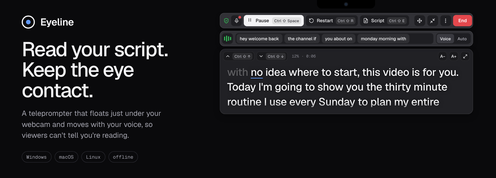
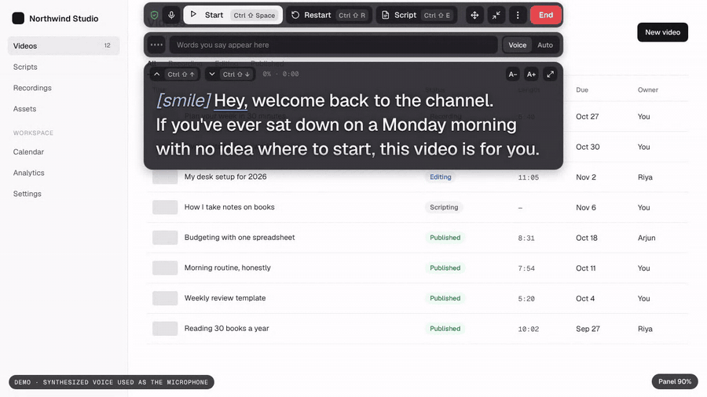
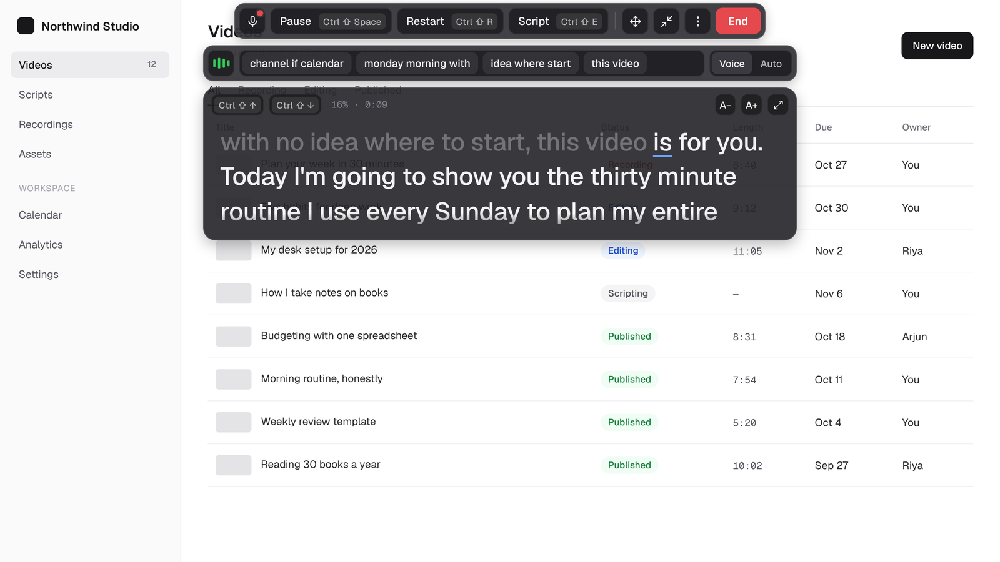
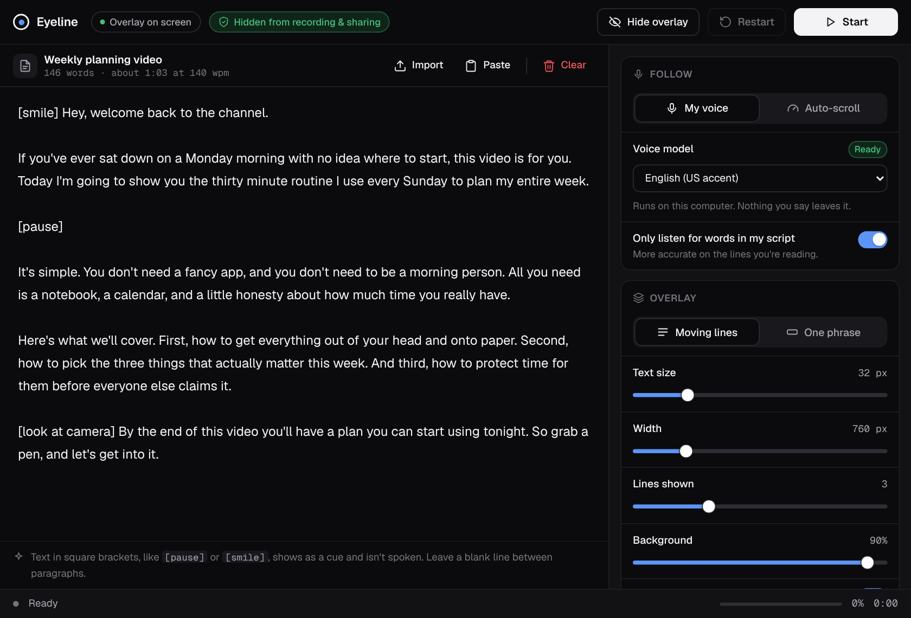

<p align="center">
  
</p>

<p align="center">
  <a href="https://github.com/HarshSharma-28/eyeline/releases/latest"></a>
  
  
  <a href="LICENSE"></a>
</p>

When you read a script on camera, your eyes sweep left to right across each line, and viewers can see it. Eyeline puts the script in a short, see-through strip right under your webcam and moves it along as you talk. Your eyes stay a few centimetres from the lens and hardly move, so on camera you look like you're talking to the viewer.

Speech recognition runs on your own computer. Nothing you say is sent anywhere, and voice follow works without an internet connection.

<p align="center">
  
</p>

## Download

| System | File | Notes |
|---|---|---|
| Windows 10 / 11 (64-bit) | [Eyeline-Windows.zip](https://github.com/HarshSharma-28/eyeline/releases/latest/download/Eyeline-Windows.zip) | Unzip and run `Eyeline.exe`. If SmartScreen warns you, click More info, then Run anyway. |
| Mac with Apple Silicon (M1 and newer) | [Eyeline-Mac-AppleSilicon.zip](https://github.com/HarshSharma-28/eyeline/releases/latest/download/Eyeline-Mac-AppleSilicon.zip) | Needs a one-line unblock the first time, see [below](#first-run-on-a-mac). |
| Mac with Intel | [Eyeline-Mac-Intel.zip](https://github.com/HarshSharma-28/eyeline/releases/latest/download/Eyeline-Mac-Intel.zip) | Same as above. |
| Linux (x64) | [Eyeline-Linux-x64.tar.gz](https://github.com/HarshSharma-28/eyeline/releases/latest/download/Eyeline-Linux-x64.tar.gz) | Extract and run `./eyeline.sh`. |

Each download is about 160 MB, including the English voice model. Every archive has a `READ ME FIRST.txt` with the setup steps for that system.

### First run on a Mac

Eyeline isn't signed with a paid Apple developer certificate yet, so macOS blocks it until you unblock it. Drag `Eyeline.app` into Applications, then paste this into Terminal once:

```sh
xattr -cr /Applications/Eyeline.app && codesign --force --deep --sign - /Applications/Eyeline.app
```

The first part removes the "downloaded from the internet" flag. The second signs the app on your own Mac using Apple's built-in `codesign` tool, which Apple Silicon needs before it will run the app. After that, open Eyeline normally and allow the microphone when asked.

## What it does

<p align="center">
  
</p>

The overlay floats above every app in three pieces. The top bar holds the controls, each labelled with its shortcut. The bar under it shows the words Eyeline just heard, so you can tell at a glance that it's keeping up. Your script sits in the panel below.

- Voice follow moves the script to the word you're on as you say it. Spoken words fade and the next one is underlined. It holds still while you pause or ad-lib, and jumps ahead if you skip a sentence.
- Auto-scroll runs at a steady words-per-minute speed for when you'd rather not use the microphone.
- Moving lines shows a few short lines that slide up. One phrase shows only the next few words, which keeps eye movement to a minimum.
- Clicks on the script text pass through to the app underneath, so you can keep working in your slides or recorder. The bars stay clickable.
- Drag the overlay anywhere by its move button or the empty parts of its bars. It reopens where you left it.
- Hide from screen recordings keeps Eyeline out of screen shares and recordings while you still see it. How well that works depends on the operating system, as the next section explains.
- Cues in square brackets, like `[pause]` or `[smile]`, show up in blue and aren't expected to be spoken.
- Paste a script or upload a `.txt` or `.docx` file. Edits in the main window reach the overlay as you type.
- You can change the text size, line length, number of lines, words per phrase and background opacity (all the way to fully clear), and turn on a text shadow, a compact view, or script-above-controls so the words sit closest to the camera.
- Global shortcuts work while you're in another app.
- English (US accent) is built in. English (Indian accent) and Hindi download once, 35 to 45 MB each, the first time you pick them.

<p align="center">
  
</p>

## Hiding from screen recording and screen sharing

With Hide from screen recordings switched on (the default), Eyeline asks the operating system to leave its windows out of screen capture. You still see them normally. How much the operating system honours that request varies a lot:

| | Result |
|---|---|
| Windows 10 (version 2004 or later) and 11 | Both Eyeline windows are left out of OBS, Zoom, Teams, Google Meet, Discord and Snipping Tool. The taskbar icon still shows in a whole-screen share. |
| macOS 15 and later | Hidden from Google Meet in Chrome. Zoom, the new Teams, QuickTime, Mac screenshots and recent OBS capture through Apple's ScreenCaptureKit, which ignores the request. Apple gives apps no public way to block it. |
| Linux | Not possible. Under X11 any app can read the screen, and Wayland shares whole monitors through the desktop portal with no way to exclude a window. |

On a Mac or on Linux, share or record a single window, such as your browser or your slides, and Eyeline stays out of the picture. On every system, a phone camera or an HDMI capture card will still see it.

## Shortcuts

They work in any app. On a Mac, use <kbd>⌘</kbd> in place of <kbd>Ctrl</kbd>.

| Shortcut | Action |
|---|---|
| <kbd>Ctrl</kbd> <kbd>Shift</kbd> <kbd>Space</kbd> | Start or pause |
| <kbd>Ctrl</kbd> <kbd>Shift</kbd> <kbd>↑</kbd> / <kbd>↓</kbd> | Back or forward one line |
| <kbd>Ctrl</kbd> <kbd>Shift</kbd> <kbd>←</kbd> / <kbd>→</kbd> | Slower or faster (Auto mode) |
| <kbd>Ctrl</kbd> <kbd>Shift</kbd> <kbd>R</kbd> | Back to the start |
| <kbd>Ctrl</kbd> <kbd>Shift</kbd> <kbd>E</kbd> | Open the script window |
| <kbd>Ctrl</kbd> <kbd>Shift</kbd> <kbd>H</kbd> | Show or hide the overlay |
| <kbd>Ctrl</kbd> <kbd>Shift</kbd> <kbd>L</kbd> | Turn click-through on or off |

## How voice follow works

Eyeline runs [Vosk](https://alphacephei.com/vosk/), an offline speech recognizer, inside the app as WebAssembly through [vosk-browser](https://github.com/ccoreilly/vosk-browser). The microphone feeds it audio, and it returns a running guess of the words you've just said. The English model is about 40 MB and loads in a few seconds.

With Only listen for words in my script switched on, the recognizer's vocabulary is limited to the words in your script, which makes it more accurate on the lines you're reading. Each time its guess changes, Eyeline takes the last four words it heard and looks for them among the next 30 words of the script. Close spellings count as a match, so "organiz" matches "organization" and a word that's one or two letters off still matches. The best match moves the script to the word after it.

A stray word from an ad-lib can move the script a few words at most, and only when it happens to be one of the next couple of words in your script. Jumping further needs two or more heard words in a row to line up with the script, so pausing or going off script leaves your place alone.

## Build from source

You need [Node.js](https://nodejs.org) 20 or newer.

```sh
git clone https://github.com/HarshSharma-28/eyeline.git
cd eyeline
npm install      # also copies the speech engine and fonts into app/ and downloads the voice model
npm start
```

If the model download fails during install, run `npm run fetch-model` later, or just press Start in the app and it will download it then.

To build the downloadable apps into `dist/`:

```sh
npm run dist:win     # Eyeline-Windows.zip
npm run dist:mac     # Eyeline-Mac-AppleSilicon.zip and Eyeline-Mac-Intel.zip
npm run dist:linux   # Eyeline-Linux-x64.tar.gz
npm run dist         # all of them
```

All four builds can be made on Linux or macOS. Built on a Mac, the Mac apps are ad-hoc signed; anywhere else they come out unsigned. Notarizing them for distribution needs an Apple Developer ID.

Releases are built by GitHub Actions. Bump `version` in `package.json` and push to `main`, and the [release workflow](.github/workflows/release.yml) builds the four downloads on GitHub's Linux and Mac machines and publishes them as a new release.

### Project layout

```
main.js            app windows, local file server, click-through, dragging, shortcuts, model downloads
preload.js         the small bridge the two pages use to talk to main.js
models.js          voice model list, and a zip-to-tar.gz repacker for vosk-browser
app/control.html   the main window: script editor and settings
app/overlay.html   the floating overlay: script model, voice matching, scrolling, layout
build/             icons, macOS Info.plist additions, Linux launcher, per-system READMEs
scripts/           setup, model download, packaging, Windows .exe metadata
```

Both pages are single HTML files with no framework and no bundler, so you can open one and read it top to bottom.

To see what the overlay is doing on someone's machine, put an empty file named `debug.flag` next to the app (`Eyeline.exe`, the Linux `Eyeline` binary, or inside `Eyeline.app/Contents/MacOS`). Eyeline then writes `eyeline-debug.log` there with clicks, drags and click-through changes.

## Contributing

Issues and pull requests are welcome. [CONTRIBUTING.md](CONTRIBUTING.md) explains how to run, test and package your change. Good places to start:

- Move to a supported Electron release. Eyeline is on Electron 38, whose last update shipped in March 2026.
- Replace the deprecated `ScriptProcessorNode` audio path with an `AudioWorklet`.
- Sign and notarize the Mac builds and sign the Windows build, so neither shows a security warning.
- Add an installer with Start menu, Dock and desktop entries.
- Add more voice models. Vosk has models for more than 20 languages.
- Add a mirrored-text mode for beam-splitter glass teleprompters.

## Credits

Eyeline is built on [Electron](https://www.electronjs.org) (MIT), [Vosk](https://alphacephei.com/vosk/) and [vosk-browser](https://github.com/ccoreilly/vosk-browser) (Apache 2.0), the Vosk small English model (Apache 2.0), [mammoth.js](https://github.com/mwilliamson/mammoth.js) for reading Word files (BSD 2-Clause), [fflate](https://github.com/101arrowz/fflate) for unpacking model downloads (MIT), and the [Geist](https://vercel.com/font) typeface (SIL Open Font License).

## License

[MIT](LICENSE) © 2026 Harsh Sharma
